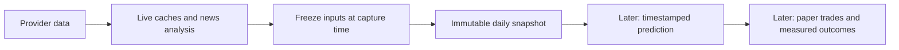

# News quality and daily snapshots: design and implementation plan

Prepared 2026-11-04 against the 0.7.2 baseline; implemented as the **0.8.0**
working-tree candidate. See [release behavior and controls](release-0.8.md) and
[verification](validation.md#08-news-and-snapshots). Optional HTTP inference and
model selection remain deferred. The original delivery order was revised on
2026-11-07: improve insider coverage, then build a news predictor/advisor, then
the paper portfolio and evaluation. These are stages of
the advisor roadmap. The first two stages ship together as 0.8.0; later stages
get their own releases. The implementation checklist is [todo08-news-snapshots.md](../todo08-news-snapshots.md).
The follow-up [API and second-score research](research-news-providers.md) selects
Massive as the first additional adapter and Marketaux as an optional numeric
cross-check, subject to actual free-account access checks.

## What a daily snapshot means

A snapshot is a small, unchanging record of the inputs trabe had at a particular
moment. It answers: **“What information did this assessment actually use?”**
It contains received prices, positions and FX, news signals, earnings/insider
facts, settings and data-quality gaps. It is not a full database backup or another
archive of every price tick. A morning Telegram briefing is a readable message;
the snapshot is the structured input record that a later predictor can reference.

For example, using invented numbers:

| Time | Live app | Saved snapshot |
| --- | --- | --- |
| 09:00 | Reference price 100; news bias +0.5; earnings pending | Freeze those values in snapshot S1. |
| 12:00 | Price changes to 96; new bearish news arrives | S1 still contains 100, +0.5 and pending earnings. |
| Next session | We measure a forecast made from S1 | Judge it using S1, not the subsequently updated inputs. |

This also applies to corrections: entering a backdated purchase tomorrow, receiving
late FX, editing an article, or revising an earnings estimate cannot rewrite S1.
Later facts affect the next snapshot. Without this boundary, an apparent successful
prediction could accidentally benefit from information learned after the decision.



## The 0.7.2 baseline and gaps addressed

| Baseline code | Previous behavior | Gap addressed in 0.8 |
| --- | --- | --- |
| `news.py: sentiment/summarize` | Small financial lexicon and short extracts | Bias is a rule score, not calibrated confidence; original bounded snippet is not retained. |
| `news.py: _merge` | Canonical URL/provider-ID deduplication | Current text is overwritten; syndicated stories at different URLs can count repeatedly. |
| News payload `symbols` | Associates one article with several tickers | A later association has no separate availability timestamp. |
| `news.py: _daily` | Freezes a small news aggregate | Uses the first UTC-day refresh, counts articles, and writes zero for no articles. It is not a deliberate decision-time snapshot. |
| `portfolio.py: schedule` | Saves values and trade identities for daily progress | Does not freeze the full price/FX/news/earnings/insider input set. |
| `signals.py: put` | Bounded current signal storage | Upserts mutable payloads; an old `available_at` does not prove the current payload was known then. |
| `Portfolio.calculate`, `FX.current`, `Ledger.positions` | Existing money calculations | Open their own connections; snapshot capture needs readers sharing one transaction. |

Keep daily portfolio progress and its arithmetic. Do not rename its existing table
or silently reinterpret old `news_daily` rows as predictor-ready snapshots.

## Stage A: useful news quality without a model dependency

### Preserve the actual input

Keep the existing Finnhub/Yahoo acquisition and shared budgets. Extend acquisition
through optional adapters: Massive first for broader news and vendor sentiment
labels; Marketaux next if a numeric vendor cross-check is wanted. Their published
limits, account checks and proposed collection budgets are in the
[provider research](research-news-providers.md). Missing new keys must not block
the improved rules release. Keep Yahoo as fallback rather than adding continuous
polling to every researched source. Alpha Vantage news is currently documented
as Premium and is not a dependency of the free plan.

Rank/group before applying the final per-ticker limit so low-value repeated
stories do not crowd out a material event. Bound the acquisition candidate pass
to 100 recent items per ticker/refresh and report capped coverage explicitly.
Save the cleaned provider headline and bounded snippet used for analysis, along
with provider IDs, canonical URL, publication time, receipt time and input hash.
Use explicit `headline_only` / `snippet` / `legacy_extract` input-quality labels.
Do not add full article scraping or invent article content beyond the supplied text.

An article has immutable observed content revisions. Repeated identical fetches
update operational last-seen metadata without creating another revision. A real
content change appends one within its provider/item stream. Different vendors'
snippets are separate input variants, not successive corrections merely because
their polls alternate. Choose a representative by versioned input-quality rules,
not last-fetch order. **A → B → A within one stream creates a new observed A occurrence**;
an old identical input can reuse inference, but cannot inherit its old occurrence
time. Revision sequence and content hash serve different purposes.
Representative quality prefers actual snippets, then actual headlines, then
legacy derived extracts. Republishing unchanged text preserves its event age;
a material A → B → A sequence gets a new occurrence, not the old A timestamp.

Store each ticker association with its own observation time. If a story first
arrived for GOOGL at 08:00 and was associated with VST at 10:00, it must not become
a VST input to a 09:00 snapshot merely because the article existed earlier.

### Add a second assessment without counting duplicate evidence

API vendor, original publisher and scoring method are separate identities.
Preserve all provider observations and annotations when canonical URLs merge;
two APIs distributing one syndicated story still contribute one event. Provider
similarity groups are hints for our grouping, not authoritative cross-feed IDs.

Our company aggregate uses one consistent rules version across eligible feeds.
Store vendor scores separately, with ticker, raw label/value, scale, supplied
evidence and first availability time. Massive's categorical label has no numeric
strength; Marketaux's matching score is not a probability. Do not average vendor
and local numbers into a false consensus or invent a model version for an opaque
vendor service. The optional model interface below remains a different experiment.

Cross-check direction on matched stories for the same company and compatible
evidence. Flag different text scope when a vendor analysed unavailable full text
and we only have a snippet. Preserve opposite/neutral disagreements. No matched
stories or missing vendor scores are unknown, not Neutral (0.0). Report matched
counts so a one-story check does not imply coverage of the whole company view.

Use independent persistent budgets/cooldowns and per-source freshness, including
manual refresh attempts. Schedule held symbols first with fair watchlist rotation;
report failed, budget-deferred, empty and truncated requests distinctly. Keep
neutral news eligible. New REST adapters run in the existing outbound worker;
configuration stays owner-only Telegram and keys stay in private bootstrap files.

### Determine relevance per company

Provider ticker tags identify candidates, not proof of direct relevance. Analyse
each target ticker separately, using issuer name/aliases, explicit cashtags,
unambiguous ticker context and supplied text. Classify relevance as `direct`,
`contextual`, `unrelated` or `unknown`, with a short evidence-based reason.

Preserve cleaned issuer names when the existing Finnhub profile is already fetched;
the current cached profile drops that field. A news-specific context resolver can
use cached metadata or a separately budgeted `SignalHTTP` profile request, without
requiring price monitoring on. Cache issuer context for seven days. Brand aliases
need an explicit versioned registry; optionally allow `/news_alias TICKER NAME`.
Ambiguous symbols such as A/ON/AI must not match ordinary words automatically.
Missing aliases yield unknown relevance, not fabricated company knowledge.

### Count events, not syndicated copies

Start with canonical IDs/URLs and exact normalized headline/content matches in a
bounded 72-hour window. Add conservative near-duplicate grouping only where the
company, time context, event type and significant facts agree. Preserve numbers,
dates, directional verbs and negation. “Guidance raised” versus “guidance cut,”
or an EPS correction, must not disappear into one unchanged event.

Group membership is versioned and timestamped. One representative observed
revision per group contributes to an aggregate. A later correction may become
the current representative, but cannot replace a member already frozen in a snapshot.
Uncertain merges stay separate; extra visible stories are preferable to merging
two distinct material events.

An unchanged syndicated copy must not reset an event's age to “breaking news.”
Use the earliest valid publication time for unchanged members. An explicitly
related material correction is a new event revision with its own publication/
availability time; current aggregation replaces the superseded claim instead of
counting both as independent evidence. If that relationship is uncertain, retain
separate items with a conflict flag rather than guessing a correction.

### Separate tone, significance and data quality

Use a small versioned event taxonomy: earnings/guidance, regulatory/legal, M&A,
financing/buyback, operations/product, analyst opinion, sector/macro and price recap.
Importance is an editorial rule, not a prediction of price movement. Down-rank
repetitive price recaps and promotional lists.

`RulesAnalyzer` first improves the current phrases with target context,
expectation-versus-actual wording, contrast clauses and mixed outcomes. Return
an unknown result when supplied evidence is insufficient. A relevant neutral
statement can have bias 0; missing evidence must use `bias=null`.

Aggregate the latest 72 hours of unique events for each ticker. Proposed initial
weights, recorded as configuration rather than claimed statistical truth:

```text
weight = relevance_weight × importance_weight × 2 ** (-age_hours / 24)
bias   = sum(weight × event_bias) / sum(eligible weights)
```

Use publication age for decay and separate receipt/analysis times for availability.
Start with direct relevance 1.0 and contextual relevance 0.25; high/medium/low
importance 1.0/0.6/0.2. Unknown/unrelated items do not enter the denominator.
Without direct company evidence, label any contextual view explicitly rather than
presenting it as a direct company signal. Record counts, disagreement/mixed flags,
excluded/unknown items, window, limits and exact weight/method versions.

The score stays within −1…+1. Opposing important events can net to zero while
carrying a mixed-signals flag. Do not describe that as confident calmness. Do not
multiply news bias by shares owned; exposure belongs to later portfolio risk logic.

### Keep Telegram concise

`/news` shows one company-level card per covered ticker, prioritising holdings.
`/news VST` shows the aggregate and up to three distinct contributing events.
Keep signed bias, a short explanation/headline, age and evidence count. Default
messages continue to omit source links and provider/version jargon. Unknown data
shows “No clear signal,” not Neutral (0.0). For example, with invented values:

```text
📰 VST • Bullish (+0.5)
2 distinct stories • guidance raised; demand improving
Second view: agrees on direction • 2 matched stories
```

The optional second-view line can also show mixed/different views, no matched
stories or unavailable data. Keep our signed bias; do not manufacture numeric
intensity from a label-only vendor result. Method details belong in an explicit
diagnostic view rather than default cards. A proposed `/news sources` reports
configured feeds, collection age, budgets and coverage; it never shows keys.

No per-headline notification stream is added. Scheduled delivery remains the
existing optional briefing. Errors/fallbacks remain brief and visible.

## Optional classifier/LLM: interchangeable and off by default

The useful news release must work with the rules baseline on the Pi. The Pi keeps
collection, storage, Telegram and scheduling. Do not install a heavyweight inference
stack or download weights as a side effect of upgrading.

The implemented `NewsAnalyzer` protocol is shared by the rules baseline and a
later optional adapter:

```python
analyze(item: dict, company: dict) -> dict
# Input: exact bounded text + target company context + input quality.
# Output: relevance, event types, importance, sentiment, bias | None,
#         mixed flag, short reason, supporting text spans and method identity.
```

An optional remote analyser receives news/ticker context, not the owner's trades
or holdings. Validate schema, enum/range bounds and supporting spans; reject
unsupported entities/numbers. Article text is data, never a source of executable
instructions. Use one bounded background queue, cancellation, timeouts, daily
limits and an inference cache keyed by the complete input hash and analyser/model/
prompt/schema versions. Copy cached inference into a newly timestamped occurrence
binding; never pretend the old inference was applied to that ticker earlier.

Run candidate models in shadow mode first. When configured but unavailable,
use labelled rules results. For a company aggregate, default to a consistent
analyser version; if preferred-model coverage is incomplete, use the complete
rules view and expose fallback rather than silently mixing incomparable scales.

Research options, not installed dependencies:

- **Finance classifier:** FinBERT is a benchmark candidate for financial sentence
  sentiment, not a complete relevance/grouping/summarisation solution. Its code
  licence and model-weight terms are different; the current owner model card
  lists CC BY-NC-SA 4.0. Pin and review the exact candidate revision before selection.
  [Original paper](https://arxiv.org/abs/1908.10063),
  [owner repository](https://github.com/ProsusAI/finBERT),
  [owner model card](https://huggingface.co/ProsusAI/finbert/blob/main/README.md).
- **LLM adapter:** a capable separate host with Ollama is one option for structured
  JSON. Its Linux instructions document AMD64/ARM64, not support for this ARMv7
  Pi; no Pi performance claim is established. JSON schema constrains output shape,
  not truth. [Linux support](https://docs.ollama.com/linux),
  [structured outputs](https://docs.ollama.com/capabilities/structured-outputs).

No paid provider or model is selected by this plan. Endpoint credentials stay in
private bootstrap configuration; ordinary choices/limits remain Telegram settings.
Model probabilities and self-reported confidence are not calibrated confidence.
[Calibration research](https://proceedings.mlr.press/v70/guo17a.html).

## Stage A code and schema

Use a separate migration from schema 5 to **6** for news quality. Proposed tables:
If another migration lands first, allocate the next versions rather than reusing
an existing schema number.

| Table | Purpose and important fields |
| --- | --- |
| `news_articles` | Stable canonical identity/provider aliases and selected representative revision pointer. |
| `news_revisions` | Append-only ID, article ID, provider/item stream, revision sequence, exact input hash, headline/snippet, source URL, publication/observation time, input quality and explicit correction relationship. Hash is indexed, not a unique occurrence ID. |
| `news_provider_observations` | Provider/item/revision identity, original publisher, bounded entity annotations/highlights and their hash, first receipt/annotation times and operational last-seen time. Changed annotations append an occurrence even if text is unchanged. |
| `news_targets` | Revision ID + ticker, association evidence and first observation for that ticker. |
| `news_analyses` | Revision/ticker binding, origin (rules/model/vendor), provider-observation ID for vendor scores, complete known input identity/basis, company context, result JSON, raw scale/label, versions or explicit unknown, completion/binding times and optional reused-analysis ID. |
| `news_event_members` | Event/ticker/revision IDs, grouping version and assignment time. Preserve prior assignments when grouping is revised. |

No existing ledger/price tables are replaced. New news tables become the news
authority behind the existing `News.report/briefing` interface. Stop dual-writing
the old mutable news aggregate once callers switch; keep legacy rows read-only
until normal expiry. Import cached old news as `legacy_extract` observed at
migration time: its original full snippet and past revision sequence cannot be
recovered. Never backfill old predictor snapshots from those reconstructed inputs.

Suggested boundaries:

| File | Responsibility |
| --- | --- |
| `news.py` | Acquisition, current public facade and concise rendering. |
| `news_store.py` | Canonical identity, per-provider revisions/observations, target associations, analysis bindings and retention. |
| `news_quality.py` | Pure relevance, grouping, tagging, ranking and aggregation functions. |
| `news_analysis.py` | Rules analyser and provider-neutral contract; optional HTTP adapter behind configuration. |
| `providers/finnhub.py` | Preserve sanitized issuer name in existing profile cache. Keep news-specific requests independent of monitor gates. |
| `news_sources.py`, `signals.py` | Small Finnhub/Yahoo/Massive adapters, later optional Marketaux; normalized observations, per-provider pacing/budgets, redaction and bounded pagination. Avoid new SDK dependencies. |
| `insights.py`, `preferences.py`, `bot.py` | Existing worker integration, validated settings and optional alias/analyser controls. |

## Stage B: freeze one decision-input packet

Use a separate schema **6 → 7** migration for `decision_snapshots` and
`snapshot_runs`. The first contains immutable payloads; the second tracks
scheduled attempts, completion/missed status and uniqueness. Keep scheduler and
delivery bookkeeping out of the immutable payload.

### Capture and timing defaults

- Automatic snapshots default off; `/snapshot on` enables them.
- Default timing is **30 minutes before the verified US core-session open**.
  Use the existing exchange calendar, including holidays/DST, and display the
  resulting time in the owner's timezone. A custom `HH:MM` uses that timezone.
- An optional one-shot preparation job, ten minutes before capture, queues a
  bounded news refresh/analysis through existing budgets. Capture never waits
  indefinitely for it. Calendar/insider/FX workers retain their normal policies.
- Preparation is automatic work: persist its origin, session/deadline and
  `gate_feature=snapshot` in the job. Do not route it through the current manual
  refresh path unchanged, since manual refreshes intentionally work while paused.
  Check snapshot enablement/global pause/storage state before every call, cancel
  obsolete preparation after off/missed deadlines and keep owner-requested manual
  jobs independent. Enabling snapshots should explain that this also enables the
  one daily news preparation; standalone `/news off` controls its own collection.
- Integrate scheduling into the existing maintenance worker's approximately
  30-second pass; no extra poller or model thread per ticker.
- Use the actual capture time as `as_of`, with `scheduled_for` recorded separately.
  Allow up to five minutes of labelled late capture. After that, mark the run
  missed. Never recreate an earlier snapshot using newer current data.
- One automatic snapshot per US session, even through restarts or timezone edits.
  A manual capture has its own ID/kind and never replaces the scheduled record.
- Scheduled captures are silent. The briefing may reference their status; viewing
  a snapshot sends a compact summary. Global pause suppresses automatic work.

Snapshot time and briefing time are independent. An earlier briefing can show the
previous snapshot and today's planned capture, not claim today's packet already
exists. When a message explains a particular snapshot, render its saved packet
rather than recomputing live values under that snapshot's ID.

### Packet contents

Freeze the union of watched and held symbols, including symbols with missing data:

| Component | Saved values |
| --- | --- |
| Identity | Snapshot ID, US session date, reason, scheduled time, actual capture/as-of time, app/schema/algorithm versions and content hash. |
| Context | Reporting currency, relevant settings, watchlist/held identities and ledger/configuration hashes. |
| Positions | Decimal quantities, remaining basis, realized/unrealized result, values and explicit missing fields. Never assume an account cash balance. |
| Prices | Exact chosen source/feed/currency, value, source/receipt times, price kind, session/coverage quality and reference age. |
| FX | Exact rate/direction, effective date, provider and receipt time used for valuation. |
| News | Local aggregate, unique-event counts, mixed/unknown flags, exact analyser/grouping versions and up to three compact evidence records per ticker. Copy available vendor assessments, comparison basis/direction and matched/unmatched counts; at most two vendor assessments per evidence record. |
| Earnings | Expected date/window/period, EPS/revenue expectations, actuals already received, result status and observation times. |
| Insiders | Recent qualified facts, publication/first-seen times and qualification/settings version. |
| Quality | Missing, stale, partial, unverified, truncated or pending components; provider attempts, failures, budget deferrals and thin-page coverage. |

Copy the values and short evidence needed to explain a decision. IDs alone are
insufficient because ordinary feed records expire. No full article bodies,
raw tick archive, credentials or Telegram tokens enter a snapshot. Financial
amounts are decimal strings, never silently converted through floats.

Before the market opens, yesterday's last received core-session price is normally
the appropriate reference. Match it to the previous verified US session; record
its age and coverage. Do not call a legitimate previous-session reference “fresh
live,” or reject every morning snapshot solely because it is older than 120 seconds.
An incomplete previous session remains flagged. This reference is context, not
an executable paper-trade fill.

Reuse established portfolio valuation semantics: a compatible Finnhub valuation
and an Alpha end-of-day watchlist reference may differ. Record the chosen role/
source instead of silently interchanging prices. Missing FX means partial value,
not a zero position. A later FX backfill or trade correction does not recalculate
the old snapshot.

### Consistency, availability and immutability

`SnapshotService.capture()` takes one short `BEGIN IMMEDIATE` transaction, checks
pause/storage/schedule rules, establishes the actual cutoff, reads persisted inputs
through that same connection, serializes the bounded packet, and atomically inserts
it with its run claim. No HTTP, clustering, inference or full-text processing occurs
inside the transaction. Use ready persisted news analyses. Add small reader methods
accepting `db` and share the existing pure `ledger.replay`/valuation arithmetic;
do not call wrappers that open unrelated connections to build one snapshot.
SQLite serializes writers and provides committed transaction isolation:
[isolation](https://www.sqlite.org/isolation.html),
[transaction semantics](https://www.sqlite.org/lang_transaction.html).

For an included news analysis:

```text
known_at = max(content_occurrence_observed_at,
               ticker_association_observed_at,
               analysis_bound_at)
known_at <= snapshot.as_of
```

Other components must have been observed/received by capture time too. Publication
date alone is not proof of availability. A future expected earnings date is valid
known information; a future actual result is not. Later model analysis of old text
gets a new binding time and cannot enter an earlier frozen record.
For a vendor assessment, also require its provider observation and annotation
receipt time to precede capture. A newly received score for an old headline
cannot be attached retroactively to an earlier snapshot.

Store canonical JSON plus SHA-256 integrity hash. Disallow UPDATE of finalized
payload/identity fields through the store API and a database trigger. Expiry may
delete an eligible whole record. A new run, changed model or corrected portfolio
gets a new ID; `/snapshot DATE` reads that saved packet, never reconstructs it
from the live database. Future forecasts reference a snapshot ID and their own
issuance time. Offline reanalysis with a later model is a new experiment, not an
original prediction rewritten after its outcome.

### Telegram controls and code boundaries

Proposed commands keep configuration in the bot:

| Command | Behavior |
| --- | --- |
| `/snapshot` or `/snapshot latest` | Inspect the last frozen record and schedule/quality summary. |
| `/snapshot now` | Capture persisted inputs now; it does not force provider/model requests. |
| `/snapshot YYYY-MM-DD` | View the automatic record for that US session or its missed/expired status. |
| `/snapshot on`, `/snapshot off` | Control automatic capture; no automatic daily message spam. |
| `/set snapshot_time preopen-30m` or `/set snapshot_time 08:00` | Default relative timing or explicit owner-local time. |

Implement `SnapshotStore`/`SnapshotService` in `snapshots.py`; add scheduling to
`workers.py`, owner dispatch in `bot.py`, validation in `preferences.py`, migration
in `store.py`, cleanup in `maintenance.py`, and brief snapshot status in `/status`.
Use public readers rather than calling private news/provider mutation methods.

## Storage budget

Keep automatic snapshots for **three calendar months**, matching the existing
history policy. Keep manual snapshots seven days with a global cap of 32, and
rate-limit manual creation. Limit each serialized packet to **256 KiB**. Preserve
essential financial/coverage fields; trim optional evidence first and record any
omission. A payload-limit failure is an explicit failed capture, not silently
missing stocks. Stop new captures under the existing hard disk-pressure pause.

Illustrative sizing, assuming 2 KiB per ticker plus 4 KiB shared metadata and
66 sessions; these are planning estimates, not measurements:

| Tickers | Payload per automatic snapshot | Three-month automatic payloads |
| --- | --- | --- |
| 10 | 24 KiB | 1.55 MiB |
| 50 | 104 KiB | 6.70 MiB |
| 100 | 204 KiB | 13.15 MiB |

At the 256 KiB cap, 66 scheduled packets are 16.5 MiB. SQLite indexes/WAL, manual
records, news revisions and the existing backup copies add space. Five copies
of those scheduled payloads alone would be 82.5 MiB; this is not a whole-app
upper bound. Proposed news caps: 1,000 current articles/20 per ticker, 5,000 content
revisions, 10,000 provider observations, 10,000 target associations, 10,000 analyses
and 10,000 membership records. Bound each provider annotation bundle to 4 KiB;
the observation cap therefore permits up to about 39 MiB of annotation payload
alone, before indexes/WAL, revisions and backups. These are shared caps across
all providers, not an allowance multiplied by each added feed.
Keep inputs bounded (headline 512 characters, snippet 4,096), with three-month
age expiry or these caps, whichever applies first. Evict oldest non-current
revisions/analyses first; report cap-related coverage loss. These are initial
design limits, not measured SQLite footprints. Do not retain every unchanged
polling response. Preserve snapshot evidence independently
of feed-cache deletion, without foreign-key cascades erasing decision records.

Before paper experiments need longer evaluation windows, agree retention/export
for their referenced inputs. Do not silently extend history forever or expire
inputs required by an unfinished forecast. The transaction ledger remains durable.

## Focused acceptance and evaluation

Use a small curated benchmark of roughly 60 examples, with event families kept
together across tuning and holdout groups. Cover ambiguous companies, relevance,
negation, expectation/actual contrasts, mixed outcomes, syndication, corrections
and headline-only inputs. Track relevance precision, false merges, polarity errors,
unknown coverage and grounding. A model is promoted only after critical cases pass
and it shows a documented benefit over the rules baseline on the same held-out
inputs. This benchmark is not evidence of profitable stock prediction.
[Financial-language research](https://arxiv.org/abs/1307.5336),
[evaluation metrics](https://scikit-learn.org/stable/modules/model_evaluation.html#classification-metrics).

Routine checks remain small: focused unit cases for relevance/grouping/unknown
handling; append-only A→B→A and per-ticker availability; snapshot immutability,
money/FX preservation, owner authorization, scheduling and duplicate run claims.
Use a few adapter fixtures for duplicate vendor observations, entity-specific
opposite scores, label-only strength, disagreement/missing values, thin-page
coverage, persistent budgets/429s and credential redaction. Check late vendor
annotations are excluded from earlier snapshots. Different vendors' text variants
must not manufacture repeated content corrections or erase each other's scores.
Use fixtures for optional-model timeout/malformed output. Run the optional model
benchmark only when choosing/changing a model. No routine model downloads, broad
integration replay, ARM/QEMU build matrix or storage soak. Documentation-only
planning requires no app test/build/deployment.

Done for these stages means better compact company-level news works with rules,
and a scheduled snapshot remains unchanged after later text, score, FX, trade or
earnings updates. Paper trading and actual forecasts remain the following stages.
